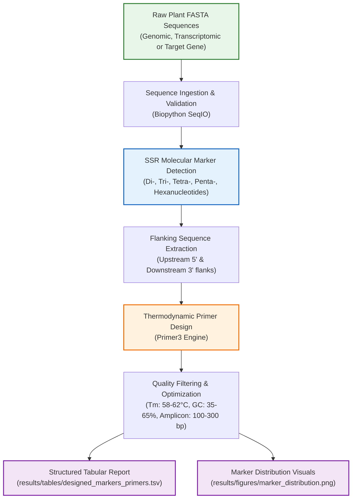

# Plant Molecular Marker Detection & Primer Design Pipeline

[](https://www.python.org/)
[](https://biopython.org/)
[](https://github.com/libprimer3/primer3-py)
[](https://opensource.org/licenses/MIT)
[](#)

An automated, reproducible bioinformatics pipeline designed for plant biotechnologists and geneticists to identify **Simple Sequence Repeats (SSRs / microsatellites)** from FASTA sequences and design flanking PCR primers for laboratory genotyping, cultivar fingerprinting, and **Marker-Assisted Selection (MAS)**.

---

## Biological Context & Motivation

Molecular markers are fundamental tools in modern plant breeding, germplasm conservation, and molecular plant pathology. Among genetic markers:

- **Microsatellites (SSRs)**: Ubiquitous, hypervariable, co-dominant, and multi-allelic tandem repeat motifs (e.g., $(GA)_n$, $(CTT)_n$).
- **Applications in Plant Science**:
  - **Cultivar Identification & Genetic Purity**: Unambiguous DNA fingerprinting of crop varieties and rootstocks.
  - **Marker-Assisted Selection (MAS)**: Tracking disease-resistance genes (e.g., $R$-genes in *Solanum* or *Triticum*) across breeding generations without phenotypic screening.
  - **Population Genetics & Gene Flow**: Assessing allelic diversity and spatial genetic structure in agricultural and wild populations.

This pipeline automates the transition from raw genomic or transcriptomic FASTA contigs to laboratory-ready PCR primer pairs optimized for standard agarose/polyacrylamide gel electrophoresis or capillary sequencer detection.

---

## Pipeline Architecture & Workflow



---

## Directory Structure

This repository follows industry standards for computational biology and reproducible data science:

```text
marker-primer-pipeline/
├── data/
│   ├── raw/                # Original, untransformed FASTA files (gitignored)
│   └── processed/          # Cleaned, filtered, or indexed sequences (gitignored)
├── examples/
│   └── sample_plant_genes.fasta  # Curated plant benchmark sequences for testing
├── notebooks/              # Jupyter notebooks for interactive analysis & figures
├── results/
│   ├── figures/            # Generated high-resolution plots (DPI 300)
│   └── tables/             # Tabular marker & primer design outputs (.tsv)
├── src/
│   ├── __init__.py         # Package initialization
│   ├── marker_detector.py  # Algorithmic detection of microsatellite motifs
│   ├── primer_designer.py  # Primer3 binding and thermodynamic parameters
│   └── pipeline.py         # End-to-end command-line orchestrator
├── .gitignore              # Bioinformatics-tailored ignore rules (BAM, FASTA, caches)
├── environment.yml         # Reproducible Conda/Mamba virtual environment definition
├── requirements.txt        # Python package dependencies (pip)
└── README.md               # Scientific project documentation
```

---

## Installation & Setup

### Option 1: Conda / Mamba (Recommended for Bioinformatics)

```bash
# Clone the repository
git clone https://github.com/<your-username>/marker-primer-pipeline.git
cd marker-primer-pipeline

# Create and activate environment
conda env create -f environment.yml
conda activate plant-marker-pipeline
```

### Option 2: Python `venv` + `pip`

```bash
# Create virtual environment
python -m venv .venv

# Activate environment
# On Windows (PowerShell):
.venv\Scripts\Activate.ps1
# On Linux/macOS:
source .venv/bin/activate

# Install dependencies
pip install --upgrade pip
pip install -r requirements.txt
```

---

## Quickstart & Usage

Run the pipeline using the included benchmark plant dataset:

```bash
python src/pipeline.py --input examples/sample_plant_genes.fasta \
                       --output-table results/tables/designed_markers_primers.tsv \
                       --output-figure results/figures/marker_distribution.png
```

### Command-Line Arguments

| Flag | Long Flag | Default | Description |
|:---|:---|:---|:---|
| `-i` | `--input` | `examples/sample_plant_genes.fasta` | Path to input multi-FASTA sequence file |
| `-o` | `--output-table` | `results/tables/designed_markers_primers.tsv` | Path for TSV output file |
| `-f` | `--output-figure` | `results/figures/marker_distribution.png` | Path for summary frequency chart |
| | `--flank` | `150` | Nucleotide flanking window length (bp) around marker |

---

## Output Data Schema

The resulting table provides all parameters required for ordering primers and executing PCR runs:

| Field Name | Description | Example |
|:---|:---|:---|
| `sequence_id` | FASTA header identifier | `Solanum_tuberosum_R1_gene` |
| `motif_type` | Repeat motif classification | `Trinucleotide` |
| `motif` | Basic repeating nucleotide unit | `CTT` |
| `repeats` | Number of continuous tandem repeats | `6` |
| `start_1based` | 1-based start coordinate in locus | `241` |
| `end_1based` | 1-based end coordinate in locus | `258` |
| `primer_forward_seq` | 5' to 3' Forward Primer sequence | `GGCCTCTTAGATGAATTCCG` |
| `primer_reverse_seq` | 5' to 3' Reverse Primer sequence | `CCATAGAAATCAACGATGAA` |
| `primer_forward_tm` | Melting temperature ($T_m$) of forward primer | `59.8` °C |
| `primer_reverse_tm` | Melting temperature ($T_m$) of reverse primer | `60.1` °C |
| `amplicon_size_bp` | Expected PCR product length | `194` bp |
| `primer_status` | Status code (`DESIGNED` or reason for rejection) | `DESIGNED` |

---

## Roadmap & Future Enhancements

- [ ] Support for **InDel (Insertion/Deletion) & SNP** marker discovery from multi-sequence alignments.
- [ ] Integration with **NCBI E-Utilities** to fetch candidate genes directly by accession ID.
- [ ] Spatial genetic structure mapping using GIS tools (`GeoPandas` / QGIS integration for allele frequency distribution).
- [ ] Interactive Streamlit/Dash dashboard for point-and-click marker discovery.

---

## Author & Academic Background

- **Field**: Plant Biotechnology (BSc. in Plant Biotechnology)
- **Specialization**: Molecular Markers, Bioinformatics, Biostatistics, Molecular Biology & GIS.
- **GitHub**: [@your-username](https://github.com/your-username)
- **LinkedIn**: [Your Profile](https://linkedin.com)

---

## License

This project is licensed under the MIT License - see the LICENSE file for details.
