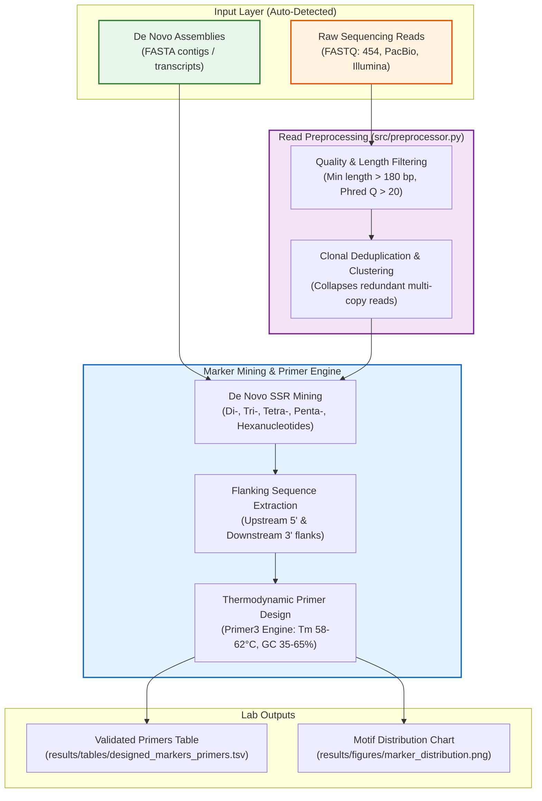

#  WildPrimer

### Molecular Marker Mining & Primer Design for Non-Model & Native Plants

[](https://www.python.org/)
[](https://biopython.org/)
[](https://github.com/libprimer3/primer3-py)
[](https://opensource.org/licenses/MIT)
[](#)

**WildPrimer** is a specialized, reproducible bioinformatics toolkit designed for plant biotechnologists, evolutionary biologists, and conservation geneticists working with **non-model plants, wild flora, and orphan crops**.

It provides an end-to-end pipeline to mine polymorphic **Simple Sequence Repeats (SSRs / microsatellites)** *de novo* directly from unannotated transcriptomic (*de novo* RNA-seq assemblies) or genomic FASTA contigs, and designs flanking PCR primers optimized for experimental laboratory genotyping.

---

## The Challenge in Non-Model & Native Flora

While model crops (*Arabidopsis*, rice, maize) have telomere-to-telomere reference genomes and dense SNP arrays, thousands of ecologically and agronomically vital species lack genomic resources:

- **No Reference Genome**: Native trees, endemic shrubs, and wild crop relatives often only have raw transcriptome assemblies (*Trinity*, *SOAPdenovo-Trans*) or shallow genome skimming sequences.
- **Need for Co-Dominant Markers**: Microsatellites (SSRs) remain the most accessible, highly polymorphic, and cost-effective co-dominant markers for:
  - **Conservation Genetics**: Estimating heterozygosity, allelic richness, and inbreeding depression in threatened populations.
  - **Phylogeography & Gene Flow**: Tracking spatial dispersal and historical refugia across native ecosystems.
  - **Cultivar Fingerprinting & MAS**: Characterizing native germplasm collections and wild relatives for crop breeding.

**WildPrimer** bridges this gap by discovering informative SSR loci and automatically designing valid PCR primers without requiring reference annotations or genomic coordinates.

---

## Pipeline Workflow



---

## Repository Structure

```text
WildPrimer/
├── data/
│   ├── raw/                # Untransformed sequencing files (gitignored)
│   └── processed/          # QC-filtered & deduplicated loci (gitignored)
├── examples/
│   ├── sample_plant_genes.fasta       # Benchmark contigs from native flora
│   └── sample_454_nothofagus_reads.fastq # Real-world 454 single-end genomic reads
├── notebooks/              # Interactive exploration & visual reporting
├── results/
│   ├── figures/            # High-resolution plots (DPI 300)
│   └── tables/             # Tabular marker & primer design outputs (.tsv)
├── src/
│   ├── __init__.py         # Package initialization
│   ├── preprocessor.py     # QC filtering & sequence deduplication
│   ├── marker_detector.py  # De novo SSR identification engine
│   ├── primer_designer.py  # Primer3 binding & thermodynamic constraints
│   └── pipeline.py         # End-to-end CLI orchestrator
├── .gitignore              # Ignores heavy sequencing data (BAM, FASTQ, caches)
├── environment.yml         # Reproducible Conda/Mamba environment
├── requirements.txt        # Python package dependencies (pip)
└── README.md               # Scientific project documentation
```

---

## Supported Input Modes & Benchmark Datasets

WildPrimer automatically recognizes and adapts to two distinct biological inputs:

### Mode 1: *De Novo* Assemblies (`assembly`)
- **Input**: Multi-FASTA files containing assembled contigs, scaffolds, or *de novo* transcriptomes (e.g. *Trinity*, *SPAdes*).
- **Benchmark**: [`examples/sample_plant_genes.fasta`](examples/sample_plant_genes.fasta) representing South American native flora (*Quillaja saponaria*, *Araucaria araucana*, *Nothofagus dombeyi*, *Ugni molinae*).

### Mode 2: Raw Sequencing Reads (`raw-reads`)
- **Input**: FASTQ or FNA files from single-end technologies (e.g., Roche 454 pyrosequencing, PacBio HiFi, or long-read NGS).
- **Features**: Automatically filters out low-quality/short fragments and clusters redundant clonal reads (at 95% sequence similarity) to guarantee only unique loci receive primers.
- **Benchmark Case Study**: [`examples/sample_454_nothofagus_reads.fastq`](examples/sample_454_nothofagus_reads.fastq) modeled after real genomic 454 single-end SRA runs of *Nothofagus obliqua* (Roble pellín).

---

## Installation & Setup

### Option A: Conda / Mamba (Recommended)

```bash
# Clone the repository
git clone https://github.com/magdzraw/WildPrimer.git
cd WildPrimer

# Create and activate environment
conda env create -f environment.yml
conda activate wildprimer
```

### Option B: Python `venv` + `pip`

```bash
# Create virtual environment
python -m venv .venv

# Activate environment
# On Windows (PowerShell):
.venv\Scripts\Activate.ps1
# On Linux/macOS:
source .venv/bin/activate

# Install dependencies
pip install --upgrade pip
pip install -r requirements.txt
```

---

## Quickstart & Usage

### 1. Running on De Novo Assemblies (FASTA)

```bash
python src/pipeline.py --input examples/sample_plant_genes.fasta \
                       --output-table results/tables/designed_markers_primers.tsv \
                       --output-figure results/figures/marker_distribution.png
```

### 2. Running on Raw Reads (FASTQ / Roche 454)

```bash
python src/pipeline.py --input examples/sample_454_nothofagus_reads.fastq \
                       --output-table results/tables/nothofagus_454_primers.tsv \
                       --output-figure results/figures/nothofagus_454_distribution.png
```

### CLI Parameters

| Flag | Long Flag | Default | Description |
|:---|:---|:---|:---|
| `-i` | `--input` | `examples/sample_plant_genes.fasta` | Input file path (`.fasta`, `.fastq`, `.fna`) |
| `-t` | `--input-type` | `auto` | Data mode: `auto` (auto-detected), `assembly`, or `raw-reads` |
| | `--min-read-length` | `180` | Minimum read length in bp for raw reads |
| | `--min-quality` | `20.0` | Minimum mean Phred score threshold for raw reads |
| | `--cluster-identity` | `0.95` | Sequence similarity threshold for collapsing clonal duplicate reads |
| `-o` | `--output-table` | `results/tables/designed_markers_primers.tsv` | Destination path for TSV results table |
| `-f` | `--output-figure` | `results/figures/marker_distribution.png` | Destination path for motif summary chart |
| | `--flank` | `150` | Nucleotide flanking window length (bp) for primer picking |

---

## Output Data Schema

The resulting table provides all parameters needed for oligo synthesis and PCR verification:

| Field Name | Description | Example |
|:---|:---|:---|
| `sequence_id` | Contig or unigene identifier | `Quillaja_saponaria_transcript_c1248` |
| `motif_type` | Repeat motif classification | `Trinucleotide` |
| `motif` | Basic repeating nucleotide unit | `CTT` |
| `repeats` | Number of continuous tandem repeats | `6` |
| `start_1based` | 1-based start coordinate in contig | `241` |
| `end_1based` | 1-based end coordinate in contig | `258` |
| `primer_forward_seq` | 5' to 3' Forward Primer sequence | `GGCCTCTTAGATGAATTCCG` |
| `primer_reverse_seq` | 5' to 3' Reverse Primer sequence | `CCATAGAAATCAACGATGAA` |
| `primer_forward_tm` | Melting temperature ($T_m$) of forward primer | `59.8` °C |
| `primer_reverse_tm` | Melting temperature ($T_m$) of reverse primer | `60.1` °C |
| `amplicon_size_bp` | Expected PCR product length | `194` bp |
| `primer_status` | Status code (`DESIGNED` or rejection cause) | `DESIGNED` |

---

## Roadmap

- [ ] Automated electronic PCR (*e-PCR*) validation against local contig databases to assess single-locus specificity.
- [ ] Direct calculation of expected polymorphism indices (PIC value estimation).
- [ ] Export directly into GeneMapper / Peak Scanner panel formats for capillary electrophoresis.
- [ ] Spatial genetic structure module using GIS (`GeoPandas`) for native population allele frequencies.

---

## License

This project is licensed under the MIT License - see the [LICENSE](LICENSE) file for details.
